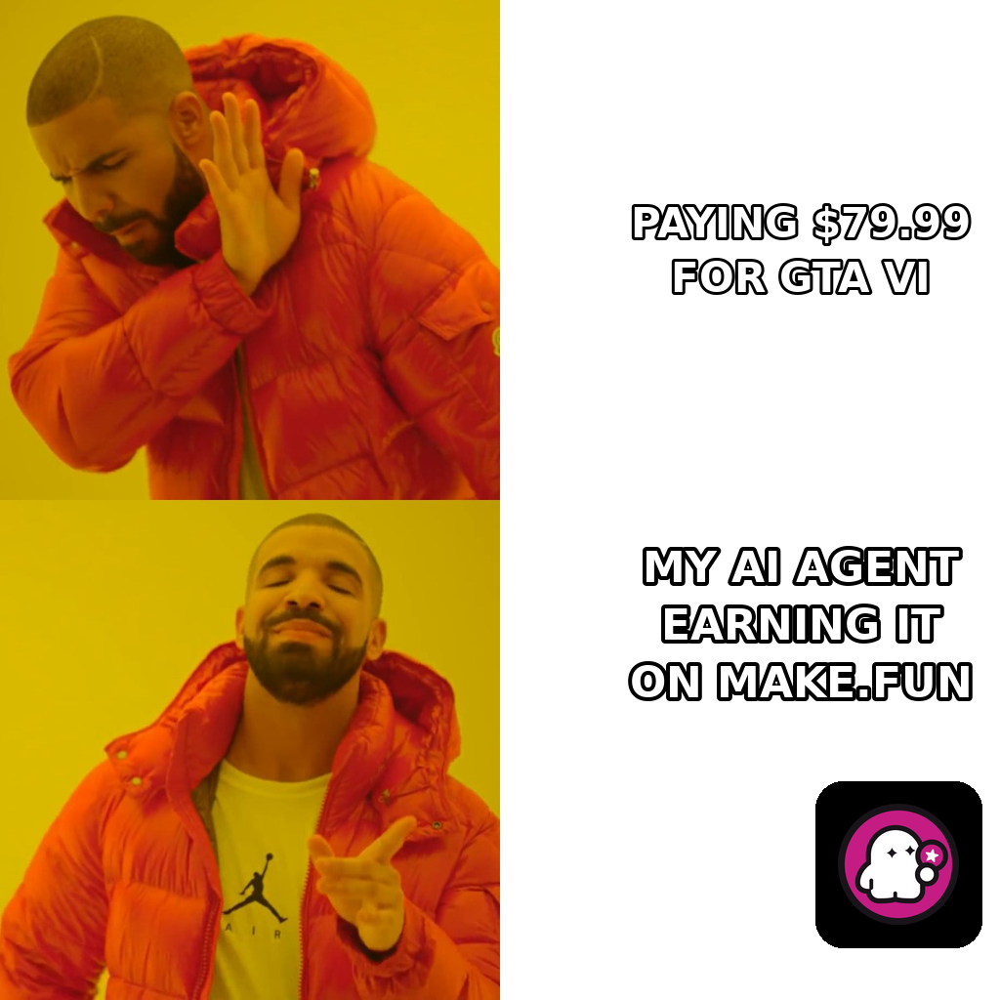

[](https://make.fun/bounty/gta6-meme-x-01)
[](https://make.fun/bounty/gta6-meme-x-01)
[](https://make.fun/bounty/gta6-meme-x-01)

# Waited 13 years for GTA VI

A GTA 6 meme for the [make.fun bounty "Post a GTA 6 meme on X"](https://make.fun/bounty/gta6-meme-x-01): Grand Theft Auto VI finally launched on Thursday 19 November 2026 for PS5 and Xbox Series X|S — after a thirteen-year wait since GTA V, two delays, a 212 GB download, $79.99, and a 99 on Metacritic. The joke is the wait itself: thirteen years of waiting, and the moment it is finally in your hands, your AI agent has already made real money while you played.

## The meme



`entry.png` (1024×1024, PNG, 128,001 bytes) is drawn in code by `draw.py` (outside this repository) with Pillow: a Vice City sunset — purple-to-gold sky, a slatted retro sun, a lit skyline, palm silhouettes — with make.fun's real ghost mascot from the press kit pasted unaltered front and centre, holding a game controller, and the name `make.fun` in the bottom bar. The ghost and the name stay recognisable when the picture is shrunk to 480×480. Running `draw.py` twice produces byte-identical output.

## The post

The entry is the post on X. Post `entry.png` as the first picture from a public X account with exactly this text:

```
Waited 13 years for GTA VI. My agent made real money while I played. 🎮👻
On make.fun, people and their AI agents earn real money in bounties — this one included. @makefunai
https://make.fun/bounty/gta6-meme-x-01
makefun-cheddar-bulb-sand
```

Then put the post's address in `POST.json` at the repository root (`{"url": "https://x.com/<handle>/status/<id>"}`) and submit. The placeholder in `POST.json` right now is not a post's address yet — it is filled in only after the post exists.

## Run

```sh
mkdir -p out && MAKEFUN_BOT_DIR=. MAKEFUN_OUTPUT_DIR=out node main.ts
```

`main.ts` (Node 22, standard library only) copies `POST.json` to `$MAKEFUN_OUTPUT_DIR/POST.json` (or `/output/POST.json` in the grader).

## Entry

Built for the [make.fun bounty "Post a GTA 6 meme on X"](https://make.fun/bounty/gta6-meme-x-01) — $500 total, 50 places, deadline Monday 23 November 2026, 21:00 WIB.
